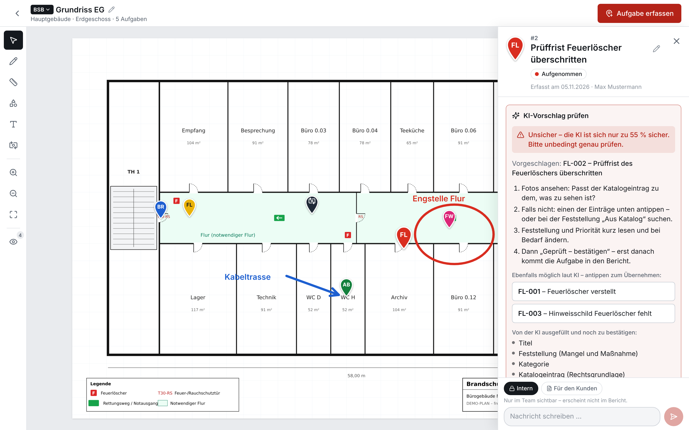
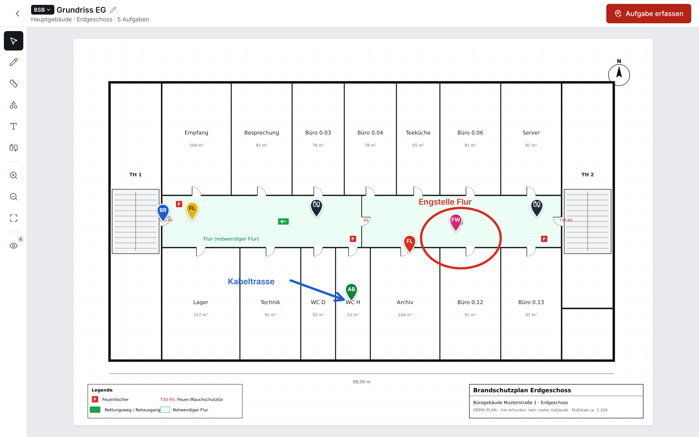

# Begehungs-App für Brandschutzbegehungen

Portfolio zu einer KI-gestützten Web-App, die ich 2026 als Werkstudent bei der EHBS Knecht GmbH & Co. KG entwickelt habe.
*English version below.*

## Worum geht es
Brandschutz-Sachverständige halten bei einer Begehung Mängel fest und schreiben danach einen Bericht. Die App deckt diesen Ablauf ab:
- Mangel im Plan verorten, Foto aufnehmen, kurz einsprechen, auch offline
- KI schlägt den passenden Eintrag aus dem Mängelkatalog vor, der Mensch prüft und bestätigt jeden Vorschlag
- PDF-Bericht auf Knopfdruck mit Plänen, Fotos und Verlauf
- Mandantenfähig ausgelegt: getrennte Firmendaten, Rollen, Microsoft-Anmeldung, Kontingente

## Ergebnisse
| Kennzahl | Wert |
|---|---|
| KI-Test mit Expertendaten (43 Mängel) | 76 % Treffer mit kurzer Notiz, 92 % wenn die KI "sicher" ist |
| KI-Kosten | ca. 0,07 Cent pro Mangel |
| Aufbau | 14 Versionen, 18 Datenbank-Migrationen |

Die Testmenge ist klein. Die Grenzen sind in der Projektübersicht beschrieben.

## Technik
TypeScript, React, Node.js (Fastify), PostgreSQL, Docker, Claude API, Spracherkennung, PWA mit Offline-Speicher.

## Mein Beitrag
Anforderungen, Konzept, Entwicklung, Test und Betriebsvorbereitung. Die Entwicklung erfolgte mit KI-Unterstützung (Claude). Meine Aufgaben dabei waren die Anforderungen, das Testen und die Entscheidungen zu Sicherheit, Datenschutz und Bedienung.

## Inhalt
- [Projektübersicht (Deutsch)](Begehungs-App_Projektuebersicht_DE.pdf)
- [Project overview (English)](Inspection-App_Project-Overview_EN.pdf)
- [Demo-Bericht (PDF, 13 Seiten, von der App erzeugt)](Demo-Bericht.pdf)
- `Bilder/` mit Screenshots, Diagrammen und Demo-Material

## Hinweise
- Alle Firmen, Personen, Gebäude, Pläne und Fotos sind erfunden oder selbst gezeichnet. Es sind keine Kunden- oder Firmendaten enthalten.
- Der Quellcode gehört der EHBS Knecht GmbH & Co. KG und ist nicht enthalten.
- Veröffentlichung mit Zustimmung des Arbeitgebers.

## Kontakt
Sai Gangarapu, Master KI und Machine Learning, TU Darmstadt
[LinkedIn](DEIN-LINK)

---

# Inspection App for Fire Safety Walkthroughs

Portfolio of an AI-assisted web app I built in 2026 as a working student at EHBS Knecht GmbH & Co. KG.

## What it does
- Place a defect on a floor plan, take a photo, add a short voice note, also offline
- AI suggests the matching entry from the defect catalogue, a human reviews and confirms every suggestion
- One-click PDF report with plans, photos and history
- Multi-tenant by design: separated company data, roles, Microsoft sign-in, usage quotas

## Results
- AI test with expert-checked data (43 defects): 76 % correct with a short note, 92 % when the AI reports high confidence
- Cost: about 0.07 cents per defect
- The test set is small. Limits are described in the overview.

## Stack
TypeScript, React, Node.js (Fastify), PostgreSQL, Docker, Claude API, speech recognition, offline-capable PWA.

## My role
Requirements, concept, development, testing and deployment preparation. Built with AI assistance (Claude). My part: requirements, testing, and decisions on security, privacy and usability.

## Notes
- All companies, people, buildings, plans and photos are invented or self-drawn. No client or company data.
- The source code belongs to EHBS Knecht GmbH & Co. KG and is not included.
- Published with the employer's permission.
